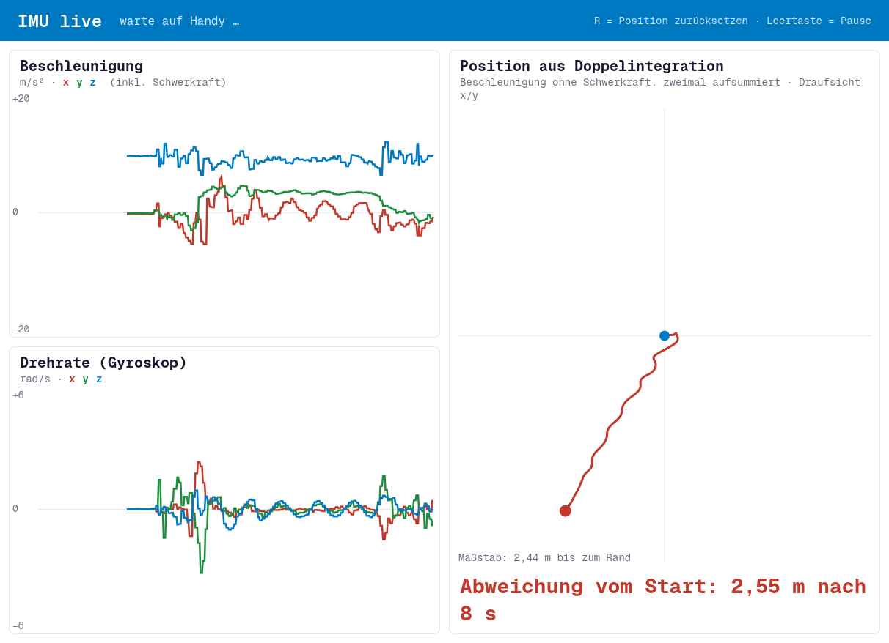

# termux-imu-live

Stream your Android phone's IMU (accelerometer, gyroscope) from [Termux](https://termux.dev) to a laptop and watch it live in the browser, including a **position estimate from double integration** that visibly drifts away even while the phone lies still.

Built as a live demo for a university talk on VR input technologies: it shows why an IMU is great for orientation but practically useless for position on its own.



**No setup at all?** `web/index.html` is a browser-only version: open it on your phone over HTTPS (live at https://imudemo.puchstein.lu) and it reads the phone's own motion sensors via the DeviceMotion API. Nothing is sent anywhere.

## What you see

- **Beschleunigung** (acceleration, m/s², incl. gravity), x/y/z over the last 10 s
- **Drehrate** (gyroscope, rad/s), x/y/z over the last 10 s
- **Position aus Doppelintegration**: linear acceleration integrated twice, top view; the distance from the start grows with every second

The UI labels are German (the talk was in German).

## Requirements

- **Phone:** Termux plus the [Termux:API](https://wiki.termux.com/wiki/Termux:API) app, and `pkg install termux-api`
- **Laptop:** Python 3 (standard library only), any browser

## Usage

On the laptop:

```sh
python3 imu_server.py
# open http://localhost:8000
```

On the phone (Termux), with the laptop's IP address:

```sh
bash -c 'termux-sensor -s "Accelerometer,Gyroscope,Linear" -d 20 > /dev/tcp/LAPTOP-IP/9000'
```

`/dev/tcp` is a bash feature, hence the `bash -c` when your Termux shell is zsh or fish.

**No shared network?** Use a USB cable and adb instead (USB debugging on):

```sh
adb reverse tcp:9000 tcp:9000
# then on the phone use 127.0.0.1 as LAPTOP-IP
```

A VPN like Tailscale also works on networks that isolate clients.

Keys in the browser: `R` resets the integrated position, `Space` pauses.
Without a phone, `http://localhost:8000/?test` shows synthetic data.

## How it works

`termux-sensor` prints pretty-printed JSON objects (`{"<sensor name>": {"values": [x, y, z]}, ...}`). The server accepts that stream on TCP port 9000, splits it into complete objects by counting braces, and forwards each one to the browser as a Server-Sent Event. The page sorts sensors by name (`accel`, `gyro`, `linear`), plots them on canvases and integrates the linear acceleration twice. If the phone has no linear-acceleration sensor, gravity is estimated with a low-pass filter and subtracted.

`python3 imu_server.py --selftest` checks the stream parser.

## AI disclosure

This project was co-authored by [Claude Opus 5.5](https://www.anthropic.com/claude) (Anthropic): the code, the browser version and this README were written with Claude, then tested on a real phone and published by Matthias Puchstein.

## License

MIT, see [LICENSE](LICENSE).
